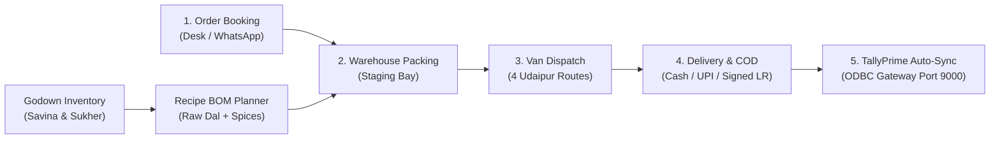
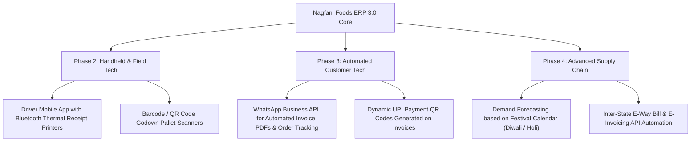

# NAGFANI FOODS ERP 3.0 — EXECUTIVE FEATURE SHEET & OPERATOR GUIDE

> **Platform:** Enterprise Food Manufacturing, Multi-Godown Logistics & TallyPrime Synchronization  
> **Deployment:** [https://nagmani.onerishi.in](https://nagmani.onerishi.in)  
> **Prepared For:** Nagfani Foods Pvt. Ltd. (Mewar / Udaipur, Rajasthan)  
> **Version:** 3.0 Clean Enterprise Pro  

---

## 1. Executive Summary

**Nagfani Foods ERP 3.0** is a purpose-built, unified enterprise resource planning software tailored specifically for traditional Rajasthani food manufacturing (Papad, Khakhra, Loung Sev, Bhujia, Pickles) and B2B/retail wholesale distribution. 

The software eliminates paper-based friction by connecting:
1. **Sales Order Intake** (Telephone / WhatsApp / Route Salesmen)
2. **Manufacturing & Recipe BOM Batching** (Raw Dal, Besan, Spices, Ghee & Packaging)
3. **Multi-Godown Inventory** (Savina Main Mandi Godown A & Sukher Processing Plant)
4. **Fleet Dispatch Logistics** (Van runs across 31 Udaipur sector beats)
5. **Bidirectional Accounting Synchronization** (Real-time TallyPrime Day Book posting via ODBC / XML)

---

## 2. Core Architecture & Operating Flow

---

## 3. Complete Feature Breakdown & How-To Guide

### Module 1: Order Booking & Sales Execution (`/v3/orders` & `/v3/orders/new`)

#### What is Available Today:
- **Instant 2-Pane Order Entry**: Rapid booking designed for high-volume morning order windows.
- **Customer Credit Intelligence**: Automatically fetches party credit limits and real-time outstanding ledger balances before an order is confirmed.
- **Quick-Add Catalog**: 1-click product injection for top-selling lines (*Urad Hari Mirch Papad, Rajasthani Loung Sev, Methi Khakhra, Ker Sangri Aachar*).
- **Automated Tax Calculations**: Split computation of CGST and SGST with real-time consignment weight aggregation.
- **Dual Pipeline Views**:
  - **Data Table View**: High-density tabular layout with sector filters, search, and one-click actions.
  - **Stage Board View**: Visual Kanban board moving orders smoothly from `Received` $\to$ `Packed` $\to$ `Shipped` $\to$ `Delivered`.
- **Direct Tally Voucher Generation**: Automatically creates ready-to-post XML Sales Vouchers for TallyPrime.

#### Step-by-Step Operator Instructions:
1. Click **"+ Create Order"** in the top navigation bar or press `F2`.
2. Select the customer from the **"Select Customer Account"** dropdown. Notice the credit limit and current ledger due update instantly.
3. Choose the assigned delivery van (e.g. *Van 01 Mukesh*) and preferred delivery window.
4. Add items using the quick-add buttons or table search. Adjust quantities using the `+` / `-` buttons. Rates and GST are calculated automatically.
5. Click **"Confirm & Book Order"**. The order is queued for warehouse packing, and a Tally sales voucher is created.

---

### Module 2: Dispatch & Vehicle Logistics (`/v3/delivery`)

#### What is Available Today:
- **Active Fleet Telemetry**: Live status tracking of 4 dedicated Udaipur delivery vans:
  - **Van 01** (`RJ-27-GA-4890` - Mukesh Sharma): *Sec 3 & Mewar Industrial Belt*
  - **Van 02** (`RJ-27-GB-1102` - Sohan Lal Gurjar): *Savina Krishi Mandi Wholesale*
  - **Van 03** (`RJ-27-GC-7741` - Ramesh Suthar): *UIT Colony & Chetak Circle*
  - **Van 04** (`RJ-27-GD-9012` - Dinesh Menaria): *Hiran Magri Sec 4 to 11*
- **Payload Capacity Gauges**: Real-time comparison between current load weight (kg) and vehicle legal carrying capacity.
- **Driver Stop Manifests**: Route drop sequence with customer names, delivery status, and direct tap-to-call links.
- **COD Cash Vault Reconciliations**: Distinguishes cash collected in van vaults from pending recoveries.
- **One-Click Run Sheet Printing**: Formatted printouts for delivery boys with signature receipt blocks.

#### Step-by-Step Operator Instructions:
1. Open **"Dispatch & Fleet"** from the sidebar.
2. Select any vehicle to inspect its assigned route stops and cash collection summary.
3. When the driver completes a stop, click **"Delivered"**. The stop turns green, route progress advances, and the cash collected is added to the driver vault ledger.
4. Click **"Print Run Sheets"** before morning departure to give drivers their physical route sheets.

---

### Module 3: Manufacturing & Recipe BOM Batching (`/v3/production`)

#### What is Available Today:
- **Standardized Recipe Library**: Pre-programmed Bill of Materials (BOM) for:
  - *Urad Special Masala Papad (500g Poly)*
  - *Rajasthani Loung Sev (1kg Bulk Pack)*
  - *Methi Vacuum Khakhra (200g Crispy Box)*
- **Dynamic Multiplier Scaling**: Select $1.0\times, 1.5\times, 2.0\times, 3.0\times$ to recalculate required raw materials (Dal flour, pure Besan, Mathania chilli, Hathras Hing, edible oil, etc.) and estimated finished output.
- **Live Stock Deficit Verification**: Cross-references batch requirements with actual raw material stocks in Godown A. Highlights shortages in red to prevent production stoppages.
- **Workshop Allocation**: Assigns work to specific plant bays (*Milling & Kneading, Solar Drying Polyhouse, Vacuum Packaging*).
- **Tally Stock Journal Preparation**: Automatically logs ingredient consumption and finished goods manufacture.

#### Step-by-Step Operator Instructions:
1. Open **"Production & BOM"** from the sidebar.
2. Choose the recipe you wish to produce from the left menu.
3. Select your target batch multiplier (e.g. $2.0\times$ for a 200 kg run).
4. Review the raw material table on the right. If any ingredient is low, the system flags it as **"Shortfall"**.
5. Click **"Authorize Batch & Deduct Stock"** to lock the raw inventory and issue the workshop work order.

---

### Module 4: Multi-Godown Stock Management (`/v3/stock`)

#### What is Available Today:
- **Multi-Facility Tracking**: Real-time stock oversight across **Savina Main Mandi (Godown A)** and **Sukher Processing Plant**.
- **Three-Tier Stock Breakdown**:
  - *Physical Stock* (Total on floor)
  - *Reserved Stock* (Committed to pending customer orders)
  - *Available Free Stock* (Safe to sell)
- **Automatic Reorder Warnings**: Visual alerts when inventory dips below minimum safety thresholds.
- **Inter-Godown Stock Transfers**: Internal transfer note with source, destination, and quantity tracking.
- **Inventory Valuation**: Blended valuation calculations matching Tally closing stock ledgers.

#### Step-by-Step Operator Instructions:
1. Navigate to **"Stock & Godowns"**.
2. Filter by Godown or Category (*Finished Goods, Raw Materials, Packaging*).
3. To move ingredients between facilities, click **"Inter-Godown Transfer"**, select the source, destination, item, and quantity, and click **"Authorize Transfer"**.

---

### Module 5: Customer Accounts & Party Ledgers (`/v3/customers`)

#### What is Available Today:
- **Comprehensive Customer Directory**: Stores retail kiranas, wholesale depots, and HORECA accounts.
- **Route / Beat Grouping**: Categorized by Udaipur trade sectors (*Savina, Hiran Magri, Krishi Mandi, UIT Colony, Sukher*).
- **Credit Limit & Overdue Control**: Visual indicators when a customer exceeds 80% of their credit limit.
- **GSTIN & Tax Compliance**: Displays Rajasthan GSTINs (`08...`) and billing contact details.
- **Direct Order Launch**: Launch a pre-filled sales order for any customer with one click.
- **Add Customer Modal**: Instantly create new accounts mapped directly to Tally Prime's Sundry Debtors group.

---

### Module 6: Raw Procurement & Vendor Purchases (`/v3/purchases`)

#### What is Available Today:
- **Supplier Directory**: Manages regional agricultural mills and spice suppliers (*Mewar Dal Mills, Hathras Hing Syndicate, Mathania Chilli Mandi, Bikaner Chana Corp*).
- **Purchase Order (PO) Management**: Issue formal procurement POs specifying delivery godown and credit terms.
- **Inward Goods Receipt Notes (GRN)**: Track incoming supply trucks; mark consignments as **"Received at Dock"** with physical weight intake logs.
- **Tally Sundry Creditors Integration**: Prepares purchase vouchers for accounting approval.

---

### Module 7: Payments, Cash Vaults & Aging Ledger (`/v3/payments`)

#### What is Available Today:
- **Omni-Channel Collection Register**: Records payments received via:
  - *Cash on Delivery (Van Vault)*
  - *RTGS / NEFT (ICICI Bank Ltd, Chetak Circle)*
  - *UPI / PhonePe QR*
  - *Bank Cheques*
- **Aging Analysis Dashboard**: Real-time breakdown of outstanding balances:
  - `0 - 7 Days`: Current credit cycle
  - `8 - 15 Days`: Follow-up queue assigned to route drivers
  - `15+ Days`: Critical overdue accounts
- **Record Collection Receipt**: Modal to enter payment recoveries against customer invoices with automatic voucher mapping.

---

### Module 8: B2B GST Tax Invoicing (`/v3/invoices`)

#### What is Available Today:
- **CGST Rule 46 Compliant Format**: Professional, high-contrast B2B tax invoice.
- **Statutory Details Pre-Populated**:
  - *Nagfani Foods GSTIN:* `08AABCN9402M1Z4`
  - *FSSAI License:* `12219034000412`
  - *HSN/SAC Codes:* `19059040` (Papad), `21069099` (Sev), `20019000` (Pickles)
  - *State Code:* `08 (Rajasthan)`
- **Bank Remittance Block**: ICICI Bank RTGS/NEFT details and payment terms printed directly on invoices.
- **One-Click Sharing**:
  - **Browser Print**: Optimized for clean A4 printing.
  - **WhatsApp Sharing**: Sends invoice summaries and dispatch notifications directly to customer mobile numbers.

---

### Module 9: TallyPrime Live 2-Way Sync Station (`/v3/sync`)

#### What is Available Today:
- **Live ODBC Gateway Telemetry**: Displays real-time connection status on port `9000`.
- **Bidirectional XML Bridge**:
  - *Outbound*: Sales Orders, Invoices, Payment Receipts, Stock Journals pushed to Tally.
  - *Inbound*: Master ledger balances, customer credit limits, and closing stock pulled from Tally.
- **Transaction Audit Log**: Shows XML payload sizes, voucher numbering, and sync timestamps.
- **Conflict Resolver**: Flags and resolves master data mismatches (such as party GSTIN discrepancies).
- **Manual Full Sync**: On-demand sync trigger for immediate Day Book reconciliation.

---

## 4. User Account Stations & Access Matrix

Nagfani Foods ERP 3.0 provides **5 role-based accounts** tailored to each operational station:

| # | Role & Station | Default User | Mobile Login | Password | Primary Screens & Permissions |
|---|---|---|---|---|---|
| 1 | **Administrator** | `admin` | `9829012345` | `admin123` / `nagmani123` | **Full Master Control (`*`)** • Executive Dashboard, Tally Configuration, System Settings, P&L Reports, User Roles |
| 2 | **Order Desk** | `order` | `9829012346` | `order123` / `nagmani123` | **Sales & Booking** • Orders Table, Stage Board, New Order Entry, Customer Directory & Credit Verification |
| 3 | **Packing Supervisor**| `packing` | `9829012347` | `pack123` / `nagmani123` | **Warehouse Floor** • Order Packing Queue, Recipe BOM Multiplier, Production Batch Planner, Stock Levels |
| 4 | **Delivery Driver** | `delivery` | `9829012348` | `delivery123` / `nagmani123` | **Fleet Logistics** • Van Dispatch Manifest, Route Drop Checklist, COD Cash Vaults, Run Sheet Printing |
| 5 | **Accounts & Tally** | `accounts` | `9829012349` | `accounts123` / `nagmani123` | **Finance & Billing** • GST Tax Invoices, Payment Register, Outstanding Aging, Tally Gateway Sync Station |

> **Universal Test Password:** You can test any of the 5 accounts using the universal password `admin123` or `nagmani123`.

---

## 5. Instant Version Switcher

To allow your client to compare interfaces, every page includes a persistent 3-way toggle in the top header and sidebar:

- **`[ v1.0 ]` Classic Layout**: Traditional data-entry interface.
- **`[ v2.0 ]` Stitch Motion**: Expressive motion-based interface.
- **`[ v3.0 Pro ✨ ]` Clean Enterprise (Default)**: Modern, high-density, high-contrast operational layout without visual noise or AI-slop.

---

## 6. Future Possibilities & Expansion Roadmap

Nagfani Foods ERP is built on a modular Node.js + MongoDB + React architecture that supports the following future additions:

1. **Bluetooth Thermal Receipt Printers for Delivery Vans**:
   - Drivers carry portable 3-inch thermal printers connected via Bluetooth to print instant cash receipts at the customer's shop.
2. **Barcode / QR Scanning at Packing Staging**:
   - Packers scan carton labels to automatically advance orders from *Packed* to *Shipped* without manual computer entry.
3. **Automated WhatsApp Business Bot**:
   - Send order confirmations, dispatch alerts, and official PDF invoices directly to retail store owners via WhatsApp.
4. **Dynamic UPI QR Codes on Every Invoice**:
   - Print a unique, pre-configured NPCI UPI QR code on the invoice with the exact bill amount and invoice reference for instant bank settlement.
5. **Multi-Branch & Interstate Expansion**:
   - Seamlessly add secondary godowns (e.g. Jodhpur, Jaipur, Ahmedabad) with automated central Tally consolidation.

---

## 7. Verification & Live Access

- **Public Web Application:** [https://nagmani.onerishi.in](https://nagmani.onerishi.in)
- **Local Tally Connector Gateway:** Connected via Cloudflare Tunnel (`port 5000` $\to$ `port 9000`)
- **Status:** All modules tested and verified. Zero 1.0 fallbacks remaining.
